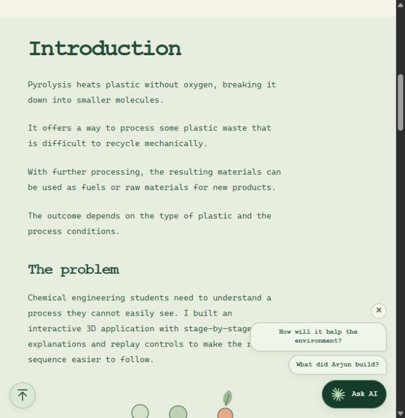
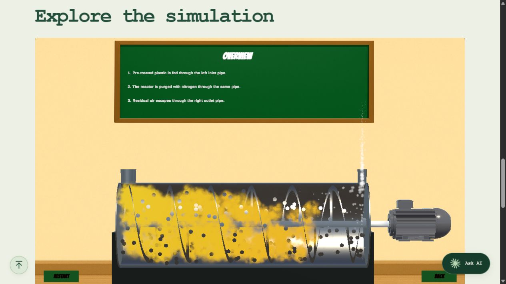

# Interactive 3D Plastic Pyrolysis Visualisation

An educational application that makes a complex chemical engineering process visible, with a public browser demo and an AI assistant.

**A product management case study by Arjun Chandra: from problem definition and MVP prioritisation to delivery and iteration.**

[Try the live product](https://pyrolysis3d.vercel.app/) · [Explore the simulation](https://pyrolysis3d.vercel.app/#simulation) · [Connect on LinkedIn](https://www.linkedin.com/in/arjunbcmsb/)



## The problem

Textbooks explain the chemistry of plastic pyrolysis, but students cannot easily see what happens inside the reactor. The challenge was to turn that hidden sequence into an experience they could follow, replay and discuss.

**Primary users:** chemical engineering students. **Product goal:** help them visualise the process through an interactive 3D application.

## My role

I led a 3-student team across chemical engineering and computer science, owning the product vision, MVP backlog, roadmap and software delivery. My teammates handled the chemical engineering work and calculations.

| Responsibility | Contribution |
| --- | --- |
| Vision and scope | Defined the educational goal, wrote user stories and acceptance criteria, and shaped the MVP backlog. |
| Prioritisation and delivery | Prioritised the core learning sequence, managed milestones and delivered the application on time despite resource constraints. |
| User experience | Made the reactor process visible through 3D animation, synchronised explanations and controls to replay the sequence. |
| Feedback and communication | Gathered and analysed qualitative feedback from professors and students, and presented the project to academic stakeholders. |
| Web launch and AI | Launched a browser demo and defined the scope and response requirements for an AI assistant using a large language model (LLM). |

## Product decisions

| Need or constraint | Decision | Trade-off |
| --- | --- | --- |
| Students need to understand a process they cannot see. | Use a semi-transparent reactor, moving particles and a rotating screw. | Prioritise visibility of the sequence over a fully opaque industrial appearance. |
| Animation alone does not explain the chemistry. | Synchronise short explanations with each stage. | Keep detail brief enough to follow while watching. |
| Students need to revisit the sequence. | Include Start, Restart and Back controls. | Focus interaction on learning and replay rather than adding a complex control panel. |
| Visitors should be able to try the application without installing software. | Publish a browser demo, show the introduction while it loads and enable Launch when ready. | Remove installation steps while making the initial loading wait clear. |
| Visitors need concise, relevant answers. | Use prompt engineering and curated project knowledge to guide the LLM assistant. | Focus on project and pyrolysis questions rather than general-purpose chat. |
| Live AI has limited capacity. | Set visitor and shared usage allowances, with prepared answers when live AI is unavailable. | Keep useful information available within resource constraints. |

## What shipped

- **A complete learning sequence:** plastic feed, nitrogen purge, heating, polymer breakdown and product release.
- **A 3D reactor experience:** Blender models, a semi-transparent chamber, automatic screw rotation, particles and timed explanations in Unity.
- **A public web experience:** a project introduction, clear loading updates, fullscreen viewing and recovery options.
- **An AI assistant:** concise answers about the project and pyrolysis, with a defined scope and fallback answers.



To try it, open the [simulation](https://pyrolysis3d.vercel.app/#simulation), wait for **Launch simulation**, then select **Start** in the Unity Home scene.

## Outcome and evidence

- **Delivery:** completed the Unity application and later launched the public web experience with an AI assistant.
- **User feedback:** qualitative feedback from university professors and students supported its usefulness as an educational visualisation.
- **Release quality:** passed 44 automated checks covering the assistant, usage controls, analytics consent and Unity integration. Browser checks covered key interactions and layouts across screen sizes.
- **Product measurement:** added optional visitor analytics with clear consent choices. Visitors can decline tracking and still use the simulation and chat.

**Next evaluation:** compare students' explanations before and after using the application to assess learning gains and identify where more guidance is needed. Evidence so far covers delivery, software testing and qualitative feedback.

## Explore the implementation

| Area | Source |
| --- | --- |
| Website and navigation | [Page](public/index.html), [styles](public/styles.css), [interactions](public/app.js) |
| Unity browser integration | [Player bridge](public/demo/player.js), [integration checks](tests/unity.test.mjs) |
| AI assistant | [API endpoint](api/chat.mjs), [curated knowledge](server/knowledge.mjs), [answer checks](tests/chat.test.mjs) |
| Usage protection | [Shared budget](server/budget.mjs), [budget checks](tests/budget.test.mjs) |
| Optional statistics | [Consent controls](public/analytics.js), [consent checks](tests/analytics.test.mjs) |

**Stack:** Unity, C#, Blender, HTML, CSS, JavaScript, Node.js, Vercel, LLM7 and Upstash Redis. The website has no npm runtime dependencies.

This repository contains the website source, server-side assistant, automated tests and compiled Unity Web export. Original Unity C# scripts, Blender source files and the private project report are not included.

## Run locally

Requires Node.js 22. No dependency installation is needed.

```sh
npm run dev
```

Open [localhost:4173](http://localhost:4173/). Without private provider configuration, the assistant uses prepared project answers. Credentials are never required to explore the website and Unity demo locally.

```sh
npm test
npm run check
```

The suite covers chat input and answer boundaries, budget reservations, analytics consent and Unity integration. [Technical setup and limitations](docs/TECHNICAL.md) describe deployment, configuration and verification scope.

## Contact

**Arjun Chandra**

[LinkedIn](https://www.linkedin.com/in/arjunbcmsb/) · [Email](mailto:arjun1300@gmail.com) · [Portfolio](https://pyrolysis3d.vercel.app/)
